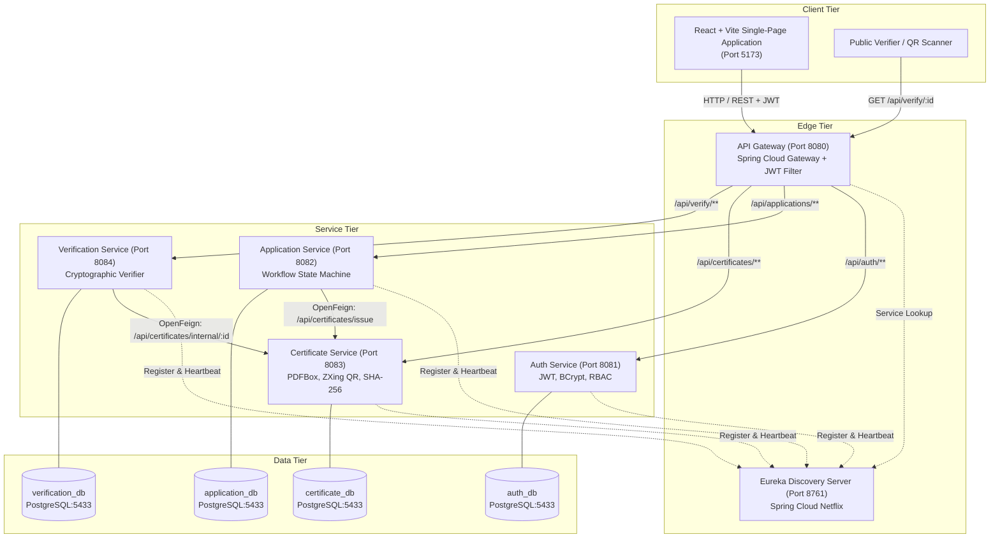

# CertiVerify Global

> **Enterprise Verifiable Digital Credentials & Certificate Lifecycle Management Engine**

CertiVerify Global is a full-stack platform designed to manage the end-to-end lifecycle of academic and institutional digital certificates. It features student application workflows, institutional review and approval, cryptographic hash generation (SHA-256), dynamic QR-code encoding, on-the-fly PDF generation, and tamper-evident public credential verification.

---

## 1. System Architecture



---

## 2. Repository Structure

```text
certificate_validation/
├── frontend/
│   ├── public/                    # Static assets & icons
│   ├── src/                       # React components, contexts, layouts, & pages
│   │   ├── components/            # Reusable UI components & ProtectedRoute
│   │   ├── context/               # AuthContext & JWT storage handler
│   │   ├── layouts/               # Role-based layouts (Student, Institution, Admin, Public)
│   │   ├── pages/                 # Portal views (Dashboard, Applications, Certificates)
│   │   ├── routes/                # Client-side router configuration
│   │   └── services/              # Axios API client with automatic JWT bearer interceptor
│   ├── package.json               # NPM package definitions
│   ├── package-lock.json          # Dependency lockfile
│   ├── vite.config.js             # Vite build & proxy settings
│   ├── .env.example               # Frontend environment template
│   └── README.md                  # Frontend development documentation
├── backend/
│   └── CertiVerify-Backend/
│       ├── api-gateway/           # Spring Cloud Gateway (Port 8080)
│       ├── auth-service/          # Authentication & Authorization microservice (Port 8081)
│       ├── application-service/   # Certificate applications microservice (Port 8082)
│       ├── certificate-service/   # Certificate generation & PDF engine (Port 8083)
│       ├── verification-service/  # Public authenticity verifier (Port 8084)
│       ├── eureka-server/         # Eureka Service Registry (Port 8761)
│       └── README.md              # Backend microservices documentation
├── postman/                       # Ready-to-import Postman request payloads
│   ├── login
│   ├── register
│   ├── application-my
│   └── certificate application
├── docs/                          # Architecture & API specifications
│   ├── architecture/
│   └── api-documentation/
├── .gitignore                     # Git ignore rules for node, java, and environments
└── README.md                      # Project root documentation
```

---

## 3. Technology Stack

- **Frontend:**
  - React 18, React Router v6
  - Vite 8 build system
  - Axios HTTP client with JWT request interceptor
  - Responsive CSS custom properties (light modern design system)
- **Backend Microservices:**
  - Java 21 / 25
  - Spring Boot 3.3.4 & Spring Cloud 2023.x
  - Spring Cloud Netflix Eureka (Service Discovery)
  - Spring Cloud Gateway (Reactive Non-blocking Gateway)
  - Spring Cloud OpenFeign (Inter-service REST Communication)
  - Spring Security with Stateless JWT Authentication & BCrypt
  - Apache PDFBox (Dynamic Certificate PDF Generation)
  - ZXing (QR Code generation embedding verification URL)
- **Database & Storage:**
  - PostgreSQL 16 / 18
  - Database-per-service pattern (`auth_db`, `application_db`, `certificate_db`, `verification_db`)
  - Spring Data JPA / Hibernate ORM

---

## 4. Service Ports & Route Mappings

| Service | Local Port | Gateway Route Prefix | Role Access |
| :--- | :--- | :--- | :--- |
| **Eureka Server** | `8761` | Direct dashboard access (`http://localhost:8761`) | Internal / Dev |
| **API Gateway** | `8080` | `http://localhost:8080` | All / Public |
| **Auth Service** | `8081` | `/api/auth/**` | Public (`/register`, `/login`) |
| **Application Service** | `8082` | `/api/applications/**` | `STUDENT`, `INSTITUTION`, `ADMIN` |
| **Certificate Service** | `8083` | `/api/certificates/**` | `STUDENT` (`/my`, `/download`), `INSTITUTION`, `ADMIN` |
| **Verification Service** | `8084` | `/api/verify/**` | Public (`GET /api/verify/{id}`) |
| **Frontend UI** | `5173` | `http://localhost:5173` | Browser Client |

---

## 5. Local Setup & Startup Instructions

### 5.1 Prerequisites
- **JDK 21 or higher** (`JAVA_HOME` configured)
- **Apache Maven 3.9+**
- **Node.js 18+ & npm**
- **PostgreSQL 16 or 18** running locally on port `5433` (or `5432` per config)

### 5.2 Database Preparation
Create the four microservice databases in PostgreSQL:
```sql
CREATE DATABASE auth_db;
CREATE DATABASE application_db;
CREATE DATABASE certificate_db;
CREATE DATABASE verification_db;
```

### 5.3 Backend Startup Sequence
Start each service in the following order:

1. **Eureka Server:**
   ```bash
   cd backend/CertiVerify-Backend/eureka-server
   mvn spring-boot:run
   ```
   *Verify dashboard is online at `http://localhost:8761`.*

2. **Auth Service:**
   ```bash
   cd backend/CertiVerify-Backend/auth-service
   mvn spring-boot:run
   ```

3. **Certificate Service:**
   ```bash
   cd backend/CertiVerify-Backend/certificate-service
   mvn spring-boot:run
   ```

4. **Application Service:**
   ```bash
   cd backend/CertiVerify-Backend/application-service
   mvn spring-boot:run
   ```

5. **Verification Service:**
   ```bash
   cd backend/CertiVerify-Backend/verification-service
   mvn spring-boot:run
   ```

6. **API Gateway:**
   ```bash
   cd backend/CertiVerify-Backend/api-gateway
   mvn spring-boot:run
   ```

### 5.4 Frontend Startup
```bash
cd frontend
cp .env.example .env
npm install
npm run dev
```
Open `http://localhost:5173` in your browser.

---

## 6. Testing Instructions

### Run Backend Unit & Integration Tests
```bash
# In each respective service directory, or via bundled Maven:
mvn -f backend/CertiVerify-Backend/certificate-service/pom.xml test
mvn -f backend/CertiVerify-Backend/application-service/pom.xml test
```

### Build Frontend Production Bundle
```bash
cd frontend
npm run build
```

---

## 7. Security Notes & Best Practices

- **Never Commit Secrets:** Real database passwords, JWT private signing keys, and environment overrides must be injected via environment variables (`JWT_SECRET`, `SPRING_DATASOURCE_PASSWORD`) in production.
- **Server-Side Authorization:** Student certificate access and PDF download endpoints enforce strict server-side identity checks against the authenticated JWT principal.
- **Microservice Isolation:** Microservices do not directly access each other's databases; all cross-service operations occur via OpenFeign client interfaces.
