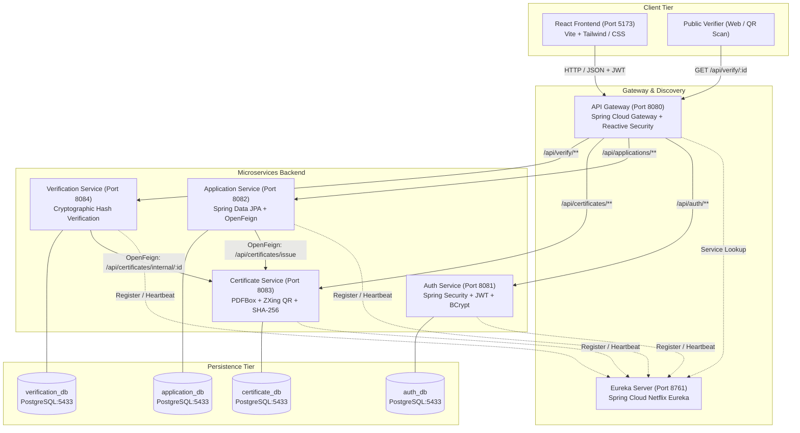
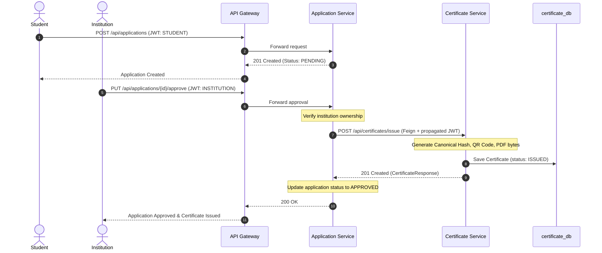
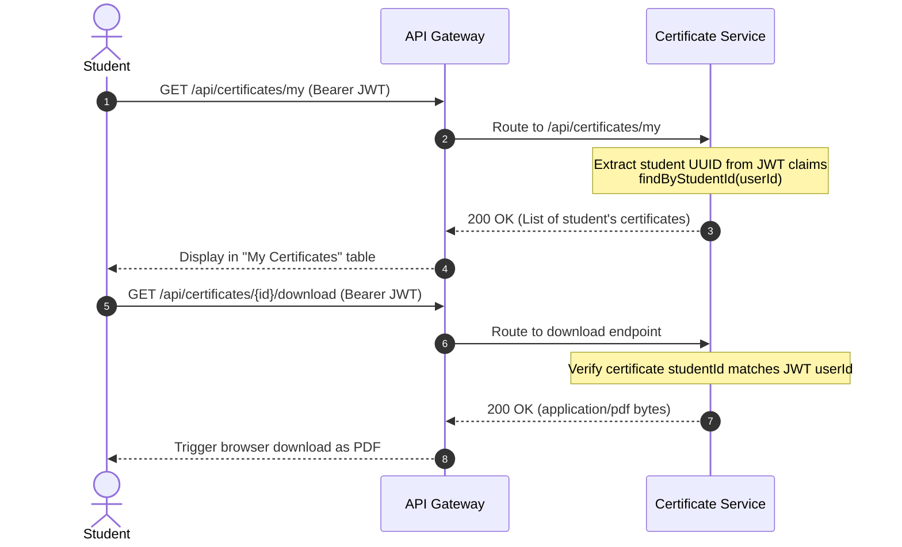

# CertiVerify Global - Architecture Documentation

## 1. System Overview

CertiVerify Global is an enterprise-grade digital credential issuance, management, and cryptographic verification platform. The system uses a microservices architecture implemented with Spring Boot and Spring Cloud, backed by a React single-page application and dedicated PostgreSQL databases for each service.

---

## 2. Microservice Topology

| Service | Port | Database | Primary Responsibility |
| :--- | :--- | :--- | :--- |
| **Eureka Server** | `8761` | None | Dynamic service registration, heartbeats, and client-side discovery. |
| **API Gateway** | `8080` | None | Central routing, CORS handling, JWT token validation, and traffic forwarding. |
| **Auth Service** | `8081` | `auth_db` | User management, registration, BCrypt password hashing, and role-based JWT issuance. |
| **Application Service** | `8082` | `application_db` | Student application lifecycle (PENDING, APPROVED, REJECTED) and Feign orchestration. |
| **Certificate Service** | `8083` | `certificate_db` | Canonical SHA-256 hashing, QR code generation, PDF generation, and student/institution retrieval. |
| **Verification Service** | `8084` | `verification_db` | Public certificate authenticity verification against cryptographic hashes. |

---

## 3. Core Business Flows

### 3.1 Application Submission & Approval Flow

### 3.2 Student Listing & PDF Download Flow

---

## 4. Security Architecture

1. **Decentralized Token Verification:**
   - Tokens are issued by `auth-service` signed with HMAC-SHA256 (`jwt.secret`).
   - `api-gateway` performs preliminary gateway-level JWT authentication.
   - Downstream services (`application-service`, `certificate-service`) employ individual `JwtAuthenticationFilter` instances, enforcing role checks (`@PreAuthorize`) and identity extraction server-side.
2. **Strict Identity Isolation:**
   - Student ID in token claims maps to the authenticated principal.
   - Cross-student access is blocked server-side: a student cannot query or download another student's certificate.
   - Non-student roles attempting to invoke `/api/certificates/my` receive `403 Forbidden`.
